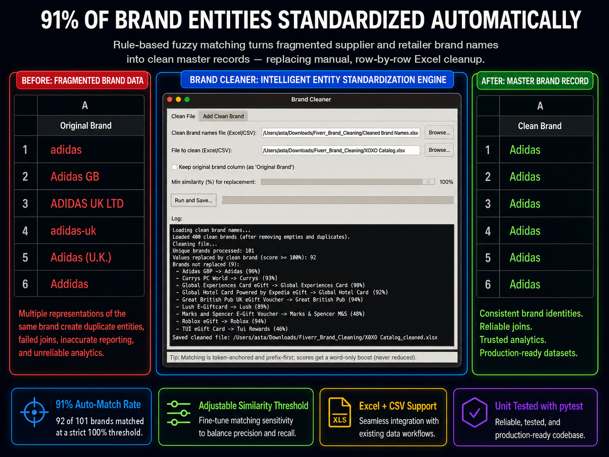
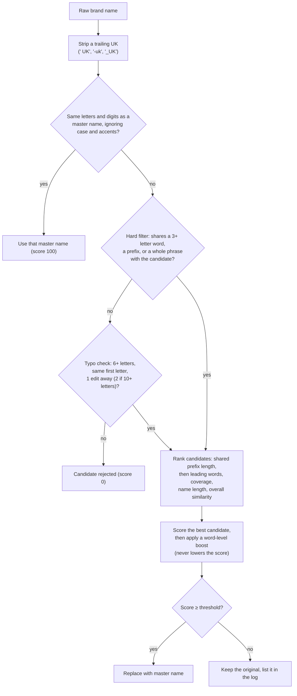
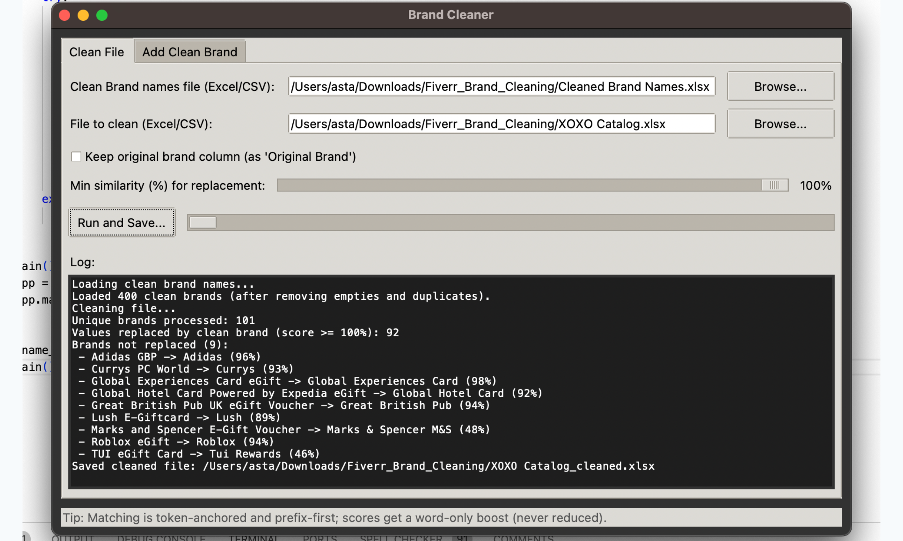

# Brand Cleaner

A desktop tool that standardizes messy brand names in supplier catalogs (Excel or CSV) against an approved master list, so the same brand isn't stored under six different spellings.



Built as freelance work for a client that combines gift card catalogs from several suppliers. Each supplier writes the same brand differently: `Adidas GB`, `ADIDAS UK LTD`, `adidas-uk`, `Lush E-Giftcard`, `Great British Pub UK eGift Voucher`. Every variant became a separate entity, which broke joins and reporting, so the names were being fixed by hand in Excel.

## Results

Run on the client's four real supplier catalogs:

| | |
|---|---|
| Unique brand names across 4 catalogs | **787** |
| Assigned a master name at the default 80% threshold | **766 (97%)** |
| Assigned a master name at a strict 100% threshold (one catalog) | **92 of 101 (91%)** |

These numbers are **coverage**, not accuracy: they count how many names the tool mapped to *some* master name, not how many it mapped to the *right* one. Correctness is measured separately with precision and recall on labelled data, see [Evaluation](#evaluation).

Brands below the threshold are never changed silently. They stay as they were, and the log lists each one with its best suggestion and score, so a person makes the final call.

## Example

Running the tool on the synthetic files in [`samples/`](samples/) (default threshold, 80%):

| Original brand | Cleaned brand | Why |
|---|---|---|
| `adidas-uk` | `Adidas` | Trailing "UK" stripped, then exact match |
| `ADIDAS UK LTD` | `Adidas` | Starts with the master name; extra words ignored |
| `Adidas (U.K.)` | `Adidas` | Punctuation ignored, then prefix match |
| `Addidas` | `Adidas` | Typo fallback: one letter off a 6+ letter name |
| `Great British Pub UK eGift Voucher` | `Great British Pub` | Master name found as a phrase at the start |
| `Global Hotel Card Powered by Expedia eGift` | `Global Hotel Card` | Same |
| `Sainsbuyrs` | `Sainsburys` | Typo fallback: two swapped letters |
| `Booths` | `Booths` (unchanged) | One letter from `Boots`, but they're different businesses, so it's left alone |
| `Marks and Spencer E-Gift Voucher` | unchanged, flagged | Known limit: "and" vs "&" isn't normalized yet |

Each row also gets a `Group code` (`tuck_<brand>`, lowercase letters and digits only) that the client uses as a join key.

## How the matching works

Generic fuzzy matching (a single similarity ratio) fails on this data in both directions. `Great British Pub UK eGift Voucher` scores low against `Great British Pub` because of all the extra words, while `Boots` and `Booths` score high despite being different businesses. So the matcher combines several signals, checked in order of how much they can be trusted:



- **Ranking puts prefixes first.** Brand names carry their identity at the start (`Adidas …`, `Currys PC World`), so candidates are compared on shared-prefix length before anything else. That makes the choice deterministic and easy to explain.
- **Scoring** ([`candidate_rank_and_score`](src/matcher.py)) = 65% prefix coverage + 20% overall similarity + 15% character coverage, minus penalties for scattered matches and for having no shared prefix.
- **Word boost** ([`enhanced_pair_score_words`](src/matcher.py)) catches cases where the words match but the characters don't line up, including fused words (`giftcard` ↔ `gift card`). It can only raise a score, never lower it.
- **No hard dependency on rapidfuzz.** Overall similarity uses `rapidfuzz` when it's installed. If it isn't, the matcher falls back to Python's built-in `difflib`, so the tool still runs instead of crashing on import.
- **The typo fallback** is deliberately narrow, and it ranks below candidates that pass the hard filter. Running the four real catalogs with and without it changed **zero** results, so it only adds matches the old matcher missed.

## Evaluation

[`eval/`](eval/README.md) measures how often the matcher is **right**, using precision (of the names it changed, how many went to the correct master) and recall (of the names that have a correct master, how many it found).

On a labelled **synthetic** set of 257 messy brand names, the real pipeline scores as follows:

<!-- results:brand_metrics.md -->
| threshold | n | correct | wrong | abstain_ok | abstain_missed | precision | recall | F1 | abstain rate |
|---|---|---|---|---|---|---|---|---|---|
| 80 | 257 | 155 | 9 | 59 | 34 | 0.9451 (155/164) | 0.8201 (155/189) | 0.8782 | 0.3619 (93/257) |
<!-- /results -->

All 9 wrong matches are different businesses that start with a master name (`Office Depot` to `Office`, `Vueling` to `Vue`). The 34 missed matches are 22 typos, 8 names written with "and" instead of "&", and 4 aliases such as `M&S`. The set is synthetic, so treat these as behaviour by case type rather than as the accuracy on client data.

The same matching ideas were also tested on the public **Abt-Buy** product matching benchmark against sentence embeddings (`all-MiniLM-L6-v2`), with thresholds tuned on a validation split and reported on a held-out test split:

<!-- results:product_metrics.md -->
| approach | threshold | n | correct | wrong | abstain_missed | precision | recall | F1 |
|---|---|---|---|---|---|---|---|---|
| A: rules | 48.1250 | 757 | 645 | 68 | 44 | 0.9046 (645/713) | 0.8520 (645/757) | 0.8776 |
| B: embeddings | 0.5305 | 757 | 542 | 213 | 2 | 0.7179 (542/755) | 0.7160 (542/757) | 0.7169 |
| A+B: embeddings + model number | 0.5995 | 757 | 676 | 72 | 9 | 0.9037 (676/748) | 0.8930 (676/757) | 0.8983 |
<!-- /results -->

Method, reproduction commands, licences and limitations are in [eval/README.md](eval/README.md).

## Project structure

```
main.py              entry point
src/matcher.py       matching: normalization, hard filter, ranking, scoring, typo check
src/processor.py     pandas I/O, UK stripping, applying matches, group codes
src/gui.py           Tkinter UI; cleaning runs on a worker thread so the window stays responsive
tests/               pytest: unit tests for matcher/processor + end-to-end test on samples/
samples/             synthetic master list and messy catalog
eval/                precision/recall evaluation and the Abt-Buy benchmark (see eval/README.md)
```

## Run it

Requires Python 3.10+.

```bash
python -m venv .venv
source .venv/bin/activate        # Windows: .venv\Scripts\activate
pip install -r requirements.txt
python main.py
```

1. **Clean File** tab: pick the master brand list and the file to clean, set the similarity threshold, then click **Run and Save**.
2. **Add Clean Brand** tab: add a new approved brand to the master list. Duplicates are ignored, regardless of case.

**Input rules:**
- Brand names must be in the **first column** of both files. Empty rows are skipped.
- Reads `.xlsx`, `.xlsm`, `.xls`, `.xlsb`, `.csv` and `.txt`.
- Always saves `.xlsx`. All other columns are kept as they were.



## Tests

```bash
pip install -r requirements-dev.txt
pytest
```

## Build a desktop app

```bash
pip install pyinstaller
pyinstaller --onefile --noconsole --name "BrandCleaner" main.py
```

The executable is written to `dist/`. On macOS, an unsigned app has to be opened once by right-clicking it and choosing **Open**.

## License

Shared for portfolio review only. All rights reserved.
