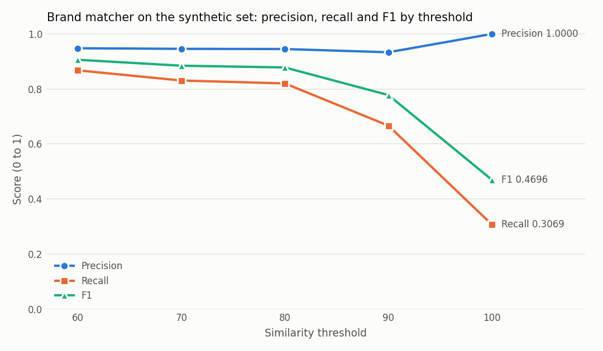

# Evaluation

This folder measures how often the brand matcher is **right**, not just how often it produces an answer, and compares rules with embeddings on a public product matching benchmark.

Two parts:

1. **Brand matcher, precision and recall.** The real cleaning pipeline (`src.processor.clean_file_with_brands`, unchanged) is run on a labelled **synthetic** set at thresholds 60, 70, 80, 90 and 100.
2. **Rules vs embeddings on Abt-Buy.** A rules-based product matcher built from the same ideas (normalisation, token overlap, leading words) plus model-number extraction, against `all-MiniLM-L6-v2` embeddings and a combination of the two. Thresholds are tuned on a validation split and reported once on a held-out test split.

Every number below is copied from a file in [`results/`](results/) that the scripts write. `tests/test_eval_readme.py` fails if a results table quoted here no longer matches those files.

## How outcomes and metrics are defined

Each item gets one outcome ([`metrics.py`](metrics.py)):

| outcome | meaning |
|---|---|
| `correct_match` | the tool gave a master name and it is the right one |
| `wrong_match` | the tool gave a master name and it is wrong, including any answer when no right one exists |
| `abstain_correct` | no right master exists and the tool left the name unchanged |
| `abstain_missed` | a right master exists but the tool left the name unchanged |

- precision = correct_match / (correct_match + wrong_match)
- recall = correct_match / items that have a right master
- F1 = harmonic mean of precision and recall
- abstain rate = (abstain_correct + abstain_missed) / all items

A ratio with a zero denominator is reported as `n/a`, never as 0 or 1. Tables show 4 decimals with the exact fraction in brackets, so nothing depends on rounding.

## Reproduce

The embedding stack needs its own environment. torch 2.2.2 is the last release with Intel macOS wheels and it needs `numpy < 2`, so these pins are kept apart from the app's `requirements.txt`.

```bash
python3.12 -m venv .venv-eval
source .venv-eval/bin/activate
pip install -r requirements-eval.txt
```

```bash
python -m eval.make_synthetic_brands --check
```

```bash
python -m eval.run_brand_eval
```

```bash
python -m eval.download_abt_buy
```

```bash
python -m eval.run_product_eval
```

```bash
pytest
```

- `make_synthetic_brands --check` confirms the committed synthetic CSVs are exactly what the seeded generator produces.
- `run_brand_eval` takes a few seconds. `run_product_eval` takes about a minute on a 2017 laptop CPU, plus the one-off model download. Embeddings are cached under `data/public/`.
- `download_abt_buy` checks the zip against a pinned SHA-256 and the published record counts. Everything under `data/` is gitignored.
- Fixed seeds everywhere (`42`). Two consecutive runs of `run_product_eval` produced byte-identical `product_metrics.md`.

## Part 1: brand matcher on the synthetic set

### Data

[`data/brand_eval_synthetic.csv`](data/brand_eval_synthetic.csv) (257 rows) and [`data/brand_master_synthetic.csv`](data/brand_master_synthetic.csv) (112 brands) are **synthetic**. The brand names are real public UK retail and gift card brands, but every messy variant was generated by [`make_synthetic_brands.py`](make_synthetic_brands.py), not taken from client files. Case types:

| case_type | rows | what it is |
|---|---|---|
| `case_only` | 15 | upper, lower or mixed case |
| `suffix` | 40 | ` UK`, `-uk`, `_UK`, ` GB`, ` GBP`, ` Ltd`, ` (U.K.)` and similar |
| `punctuation` | 30 | missing or extra spaces, hyphens, dots, `!` |
| `typo` | 45 | 1 random keyboard-style edit (2 for some names of 10+ letters), at any position |
| `long_retail_name` | 45 | gift card tails and prefixes, e.g. `Ocado Gift Card - Online Only`, `eGift Card: Steam` |
| `and_ampersand` | 8 | `Marks and Spencer` for `Marks & Spencer` |
| `alias` | 6 | trading names and short forms, e.g. `M&S`, `John Lewis & Partners` |
| `lookalike_negative` | 36 | a different real business that looks like a master brand, e.g. `Booths` / `Boots`, `Office Depot` / `Office`; no right master |
| `not_in_master` | 32 | a real brand absent from the master list; no right master |

To keep the set from flattering the matcher, case types, templates and lookalike lists were written before the matcher ran on any of it, typos are drawn at random rather than picked, and no row was edited after seeing results.

### Results

<!-- results:brand_metrics.md -->
| threshold | n | correct | wrong | abstain_ok | abstain_missed | precision | recall | F1 | abstain rate |
|---|---|---|---|---|---|---|---|---|---|
| 60 | 257 | 164 | 9 | 59 | 25 | 0.9480 (164/173) | 0.8677 (164/189) | 0.9061 | 0.3268 (84/257) |
| 70 | 257 | 157 | 9 | 59 | 32 | 0.9458 (157/166) | 0.8307 (157/189) | 0.8845 | 0.3541 (91/257) |
| 80 | 257 | 155 | 9 | 59 | 34 | 0.9451 (155/164) | 0.8201 (155/189) | 0.8782 | 0.3619 (93/257) |
| 90 | 257 | 126 | 9 | 59 | 63 | 0.9333 (126/135) | 0.6667 (126/189) | 0.7778 | 0.4747 (122/257) |
| 100 | 257 | 58 | 0 | 68 | 131 | 1.0000 (58/58) | 0.3069 (58/189) | 0.4696 | 0.7743 (199/257) |
<!-- /results -->



By case type at the default threshold of 80 (all thresholds are in [`results/brand_metrics.md`](results/brand_metrics.md)):

<!-- results:brand_metrics.md -->
| case_type | n | correct | wrong | abstain_ok | abstain_missed | precision | recall | F1 | abstain rate |
|---|---|---|---|---|---|---|---|---|---|
| alias | 6 | 2 | 0 | 0 | 4 | 1.0000 (2/2) | 0.3333 (2/6) | 0.5000 | 0.6667 (4/6) |
| and_ampersand | 8 | 0 | 0 | 0 | 8 | n/a (0/0) | 0.0000 (0/8) | n/a | 1.0000 (8/8) |
| case_only | 15 | 15 | 0 | 0 | 0 | 1.0000 (15/15) | 1.0000 (15/15) | 1.0000 | 0.0000 (0/15) |
| long_retail_name | 45 | 45 | 0 | 0 | 0 | 1.0000 (45/45) | 1.0000 (45/45) | 1.0000 | 0.0000 (0/45) |
| lookalike_negative | 36 | 0 | 9 | 27 | 0 | 0.0000 (0/9) | n/a (0/0) | n/a | 0.7500 (27/36) |
| not_in_master | 32 | 0 | 0 | 32 | 0 | n/a (0/0) | n/a (0/0) | n/a | 1.0000 (32/32) |
| punctuation | 30 | 30 | 0 | 0 | 0 | 1.0000 (30/30) | 1.0000 (30/30) | 1.0000 | 0.0000 (0/30) |
| suffix | 40 | 40 | 0 | 0 | 0 | 1.0000 (40/40) | 1.0000 (40/40) | 1.0000 | 0.0000 (0/40) |
| typo | 45 | 23 | 0 | 0 | 22 | 1.0000 (23/23) | 0.5111 (23/45) | 0.6765 | 0.4889 (22/45) |
<!-- /results -->

What this shows:

- **Every wrong match is a lookalike with a shared prefix.** All 9 are listed with scores in [`results/brand_wrong_matches.md`](results/brand_wrong_matches.md): `Office Depot` and `Officeworks` become `Office`, `Nextbase` becomes `Next`, `Vueling` becomes `Vue`, `Habitat for Humanity` becomes `Habitat`, and so on, with scores from 90.00 to 94.12. The prefix-first ranking that makes `Adidas UK Ltd` easy is the same thing that causes these. None of the 189 rows that have a right master was sent to the wrong master at any threshold.
- **The one-letter lookalikes are handled.** `Booths`, `Superdry`, `Bodum`, `Asics` and similar stay unchanged, as designed.
- **Recall is lost on typos, "and" vs "&", and aliases.** At threshold 80, 22 of 45 random typos are left for review:
  - 8 because the master name is under 6 letters (a deliberate limit of the typo fallback)
  - 4 because the typo changed the first letter (also deliberate)
  - 10 multi-word names such as `Johhn Lewis` (score 55.6) or `Ted Baler` (67.5). They still share a word with the master, so they skip the typo fallback, and the typo breaks the shared prefix that normal scoring relies on.

  All 8 `and` / `&` rows are missed (the known limitation in the main README), and so are 4 of 6 aliases.
- **Threshold 100 removes every wrong match but keeps only 58 of 189 correct matches.** Between 60 and 90 the 9 wrong matches do not change, because they all score 90 or more. Raising the threshold to stop them would cost far more recall than it saves.

### Private client set (optional)

`run_brand_eval` also runs on `data/private/brand_eval_private.csv` (same three columns) with `data/private/brand_master_private.csv` when both exist, and prints **aggregate metrics only**. No row-level value is printed or written. To prepare the files from real catalogs:

```bash
python -m eval.prepare_private_template --master "MASTER.xlsx" CATALOG1.xlsx CATALOG2.xlsx
```

This writes the master list and `brand_eval_private_TO_LABEL.csv` with empty `true_master` and `case_type` columns. The template shows no suggested match, so the tool's guess cannot bias the labels. After labelling, rename it to `brand_eval_private.csv`. No private results are reported here because no labelled private set exists yet.

## Part 2: rules vs embeddings on Abt-Buy

### Setup

- **Data:** Abt-Buy (1081 Abt products, 1092 Buy products, 1097 gold pairs). Every Abt product has at least one gold match. Only the product title (`name`) is used.
- **Task:** for each Abt product, take the best-scoring Buy product out of all 1092 (top-1 retrieval), then match if its score is at or above a threshold, otherwise abstain.
- **Split:** Abt products split once with seed 42: 324 validation, 757 test. The threshold for each approach, and the A+B weight, were chosen by best F1 on validation and applied once to test. Rule weights were fixed in code before any run and not tuned. During development only validation results were printed (`--validation-only`).
- **A, rules** ([`product_rules.py`](product_rules.py)): `0.50 * model-number signal + 0.35 * token Dice + 0.15 * same first word`. A model number is an alphanumeric code with at least one letter and one digit, excluding units such as `8MB` or `1080p`. The signal is 100 when a code agrees (exact or written inside the other title), 40 when either side has no code and 0 when both have codes that disagree. `normalize_alnum`, `tokens` and `dice_coefficient` are imported from `src/matcher.py`.
- **B, embeddings** ([`product_embed.py`](product_embed.py)): `sentence-transformers/all-MiniLM-L6-v2` pinned to Hub revision `1110a243fdf4706b3f48f1d95db1a4f5529b4d41`, on CPU, cosine similarity of normalised title embeddings.
- **A+B:** `cosine + w * signal`, where signal is +1 when model numbers agree, 0 with no evidence and -1 when they conflict. w was chosen on validation from 0, 0.05, 0.10, 0.15, 0.20, 0.30. The pick was 0.15.

### Results on the held-out test split

<!-- results:product_metrics.md -->
| approach | threshold | n | correct | wrong | abstain_missed | precision | recall | F1 |
|---|---|---|---|---|---|---|---|---|
| A: rules | 48.1250 | 757 | 645 | 68 | 44 | 0.9046 (645/713) | 0.8520 (645/757) | 0.8776 |
| B: embeddings | 0.5305 | 757 | 542 | 213 | 2 | 0.7179 (542/755) | 0.7160 (542/757) | 0.7169 |
| A+B: embeddings + model number | 0.5995 | 757 | 676 | 72 | 9 | 0.9037 (676/748) | 0.8930 (676/757) | 0.8983 |
<!-- /results -->

Retrieval quality before any threshold:

<!-- results:product_metrics.md -->
| approach | top-1 accuracy | recall@10 |
|---|---|---|
| A: rules | 0.8705 (659/757) | 0.9709 (735/757) |
| B: embeddings | 0.7173 (543/757) | 0.9670 (732/757) |
| A+B: embeddings + model number | 0.8983 (680/757) | 0.9855 (746/757) |
<!-- /results -->

Validation numbers and the full weight search are in [`results/product_metrics.md`](results/product_metrics.md). Test scores are a little lower than validation for all three approaches (F1 0.8949 to 0.8776 for A, 0.7357 to 0.7169 for B, 0.9145 to 0.8983 for A+B), which is the expected direction for choices tuned on validation.

What this shows:

- **Plain embeddings are the weakest on their own.** MiniLM puts a gold match in the top 10 about as often as the rules do (recall@10 0.9670 vs 0.9709), but ranks it first far less often (top-1 0.7173 vs 0.8705). Titles that differ only in the model code score as near-duplicates. `OmniMount TV Top Shelf Mount - CCH1B` and `... - CCH1P` have a cosine of 0.9857.
- **Model numbers carry most of the signal.** 971 of 1081 Abt titles and 890 of 1092 Buy titles contain a letter-and-digit code. Adding the code check to the embedding score raises top-1 accuracy from 0.7173 to 0.8983 and F1 from 0.7169 to 0.8983.
- **A+B beats the rules on recall at about the same precision** (0.8930 vs 0.8520 recall, 0.9037 vs 0.9046 precision), giving the best F1 of the three: 0.8983 vs 0.8776.
- **The rules miss codes written without both letters and digits.** Garmin's `010-10723-03` and Sony's `LCS-CSQ/B` are not counted as codes, so those products fall back to wording.

### Failure examples

[`results/product_failures.md`](results/product_failures.md) lists 10 test failures per approach, drawn at random with seed 42 rather than picked, each with a one-line reason generated from the scores and model numbers. The recurring patterns:

- a different model in the same product line (B mostly)
- an accessory or a multi-pack that carries the product's code (`PG-40-BK-TWIN` for `PG40BK`)
- a title with no extractable code, so generic wording decides (`LG ... Over the Range Microwave`)
- the correct product retrieved but scored just below the threshold

### Approach C: LLM on borderline pairs (optional, not run)

`python -m eval.run_product_eval --use-llm` sends only the test pairs whose A+B score is within 0.05 of the A+B threshold to Claude (`claude-opus-5-5` by default, `--llm-model` to change), asking whether the two titles are the same product. The LLM's answer replaces the threshold decision for those pairs only.

- Calls are capped (`--max-llm-calls`, default 150).
- The script prints the number of calls and an estimated cost, then asks you to type `yes` before sending anything.
- The key is read from the `ANTHROPIC_API_KEY` environment variable only.
- Answers are cached in `results/llm_judgements.jsonl`, so the reported numbers can be reproduced without new calls.
- Server-side refusal fallback (`fallbacks="default"`) is enabled on each call.

When C runs, `results/product_failures.md` also gets 10 random C failures, with reasons that say what the LLM answered.

It has not been run against the real API for this report, so there are no C numbers above. Everything except the network call itself (the request built, key handling, the confirmation prompt, answer parsing, caching, error handling and how the answers change the metrics) is covered by [`tests/test_eval_llm.py`](../tests/test_eval_llm.py), which uses a fake client.

## Datasets and licences

| item | source | licence |
|---|---|---|
| Synthetic brand set | generated by `make_synthetic_brands.py` in this repo | same as this repo. Brand names are trademarks of their owners, used only as names. |
| Abt-Buy | Database Group, Leipzig University, [benchmark datasets for entity resolution](https://dbs.uni-leipzig.de/research/projects/benchmark-datasets-for-entity-resolution) | The page says the datasets are released "under the Creative Commons license" without naming the variant. Not redistributed here; the script downloads it. Cite: H. Koepcke, A. Thor, E. Rahm, *Evaluation of entity resolution approaches on real-world match problems*, PVLDB 3(1), 2010. |
| all-MiniLM-L6-v2 | [sentence-transformers on the Hugging Face Hub](https://huggingface.co/sentence-transformers/all-MiniLM-L6-v2) | Apache-2.0 |

## Limitations

- **The brand set is synthetic.** It follows the patterns seen in real catalogs, but the mix of case types was chosen by me, so the headline precision and recall depend on that mix. For example, more typo rows would lower recall and more lookalike rows would lower precision. Read the per-case-type tables rather than the totals.
- **The brand set is small.** 257 rows and 9 wrong matches leave wide uncertainty: one more or one fewer wrong match moves precision at threshold 80 by about half a point.
- **Abt-Buy is not gift card brands.** Product titles are long and carry model numbers; brand names are short and have none. Part 2 shows how the matching ideas behave on a standard public benchmark. It does not measure the brand tool itself.
- **Abt-Buy gold labels are not perfect.** Some "wrong" matches look defensible on inspection, such as a twin pack of the same ink cartridge, but they are counted as wrong because the benchmark says so.
- **Top-1 framing.** Each Abt product gets at most one Buy match, but 16 Abt products have more than one gold match, and any of them counts as correct. Results are not comparable to papers that score pre-built candidate pairs (for example the DeepMatcher splits).
- **Titles only.** Descriptions, manufacturer and price are ignored for every approach, so the comparison is fair, but neither approach is as strong as it could be.
- **No confidence intervals.** The test split has 757 products. Differences of about a point between approaches should not be over-read.
